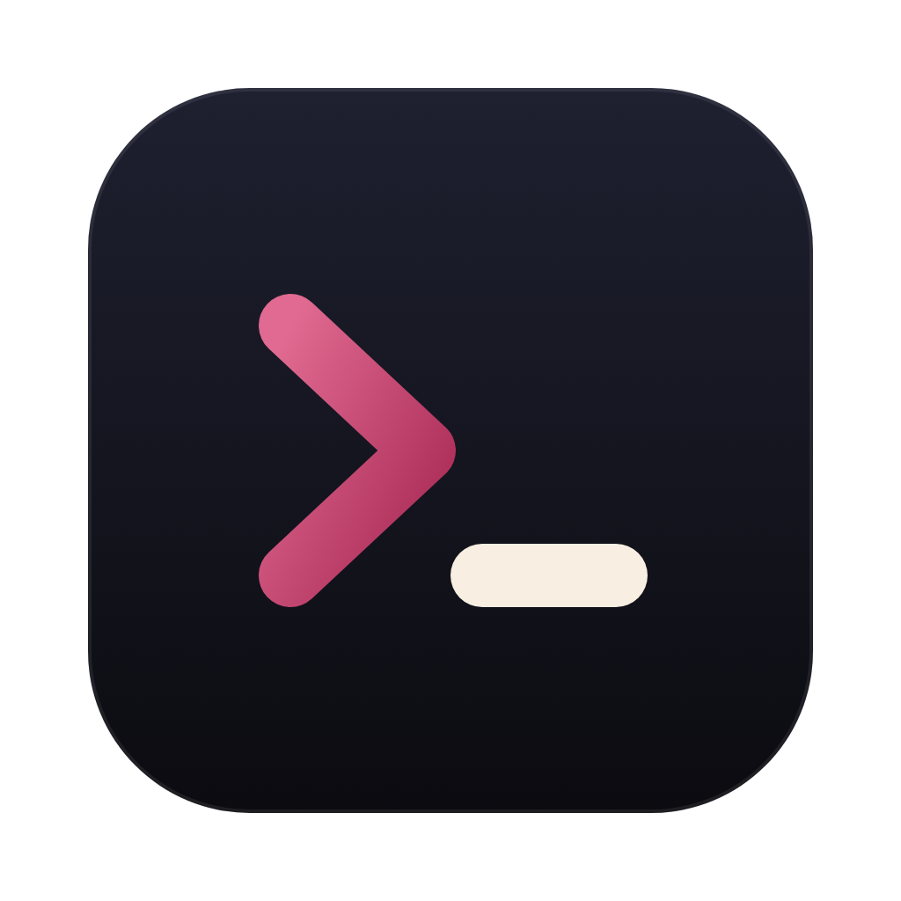
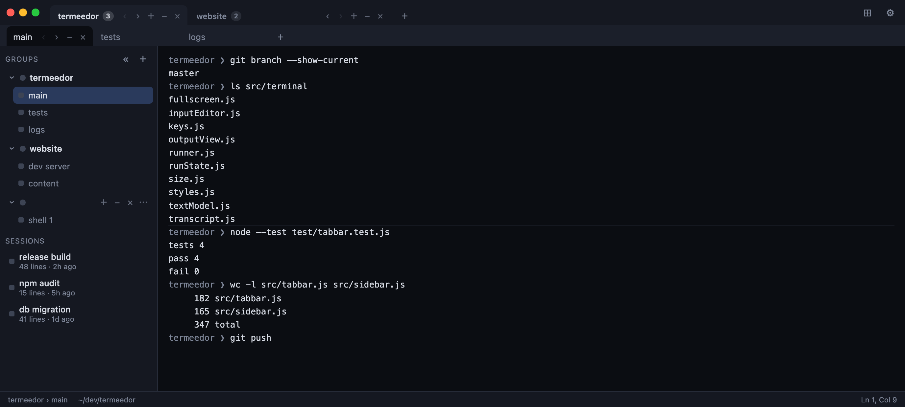

<p align="center">
  
</p>

<h1 align="center">Termeedor</h1>

<p align="center">A desktop terminal for macOS and Linux with tab groups, closed-tab history, themes and plugins.</p>

<p align="center">
  
</p>

> **Early prototype.** Expect rough edges.

Each tab runs your own zsh or bash (4.4 or newer) with your usual startup files. With any other default shell, such as fish, Termeedor uses zsh or bash instead.

## Install

### From source

You need Node.js 22 or newer. On Linux, you also need Python and a C/C++ compiler (`build-essential` on Debian and Ubuntu). On macOS, you may need the Xcode Command Line Tools.

```sh
git clone https://github.com/juancresc/termeedor.git
cd termeedor
npm install
npm start          # run the app
npm run dist       # or build installers for this system into dist/
```

### Script

```sh
curl -fsSL https://raw.githubusercontent.com/juancresc/termeedor/master/scripts/install.sh | bash
```

This installs the latest [release](https://github.com/juancresc/termeedor/releases/latest):

- **macOS:** the app, in `/Applications`, or `~/Applications` if that isn't writable.
- **Linux with `apt-get`:** a `.deb` package, using `sudo`. Run it with `termeedor`.
- **Other Linux:** an AppImage at `~/.local/bin/termeedor`. It needs FUSE 2 (`libfuse2` or `fuse-libs`).

### Homebrew (macOS)

```sh
brew tap juancresc/termeedor https://github.com/juancresc/termeedor
brew install --cask termeedor
```

To update, run `brew upgrade --cask --greedy termeedor`.

## Your data

Settings, tabs, closed tabs and plugins live in `~/.termeedor`, readable only by your user. Saved tabs include their scrollback, which can contain anything a command printed.

## Plugins

Put plugins in `~/.termeedor/plugins`. See [docs/plugins.md](docs/plugins.md) for how to write one. Plugins can run code on your computer, so only install ones you trust.

## Development

```sh
npm test               # run the tests
docker compose up      # browser version with simulated commands, at http://localhost:8876
```

See [docs/architecture.md](docs/architecture.md) for how the code is organized. To publish a release, run `npm version patch && git push --follow-tags`.
